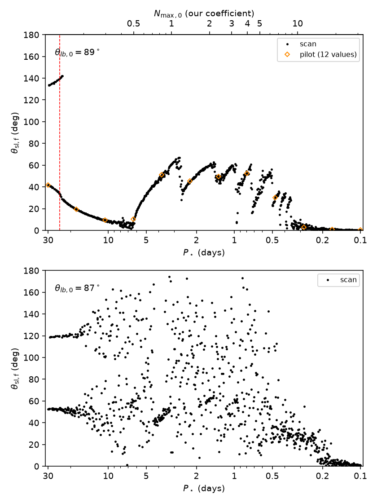

# Step 4: θ_sl,f against P★ with short-range forces and tides (Storch et al. 2016 Fig. 8)

| | |
|---|---|
| Answers brief | `docs/brief/planet-formation-and-spin-orbit-dynamics--how-does-stellar-spin-evolve-during-lidov-kozai-migration.md` |
| Brief SHA-256 | `11966760d9b6fc5e008207e46cd21e6b5dfb3c2160a9453c8ac546143dd1c3c3` |
| Work plan step | 4 (reproduce S16's θ_sl,f vs P★ figure, both orbit shapes, with SRFs and weak-friction tides, no feedback, e_b = 0) |
| Builds on | findings 01 (definitions; corrected regime-map thresholds) and 02 (validated spin integrator) |
| Date | 2026-11-17 |
| Done by | Claude: Opus 5.5 (equations and parameters from the sources, physics review of the code, comparisons, this write-up) with a Sonnet 5.5 subagent (integrator, validation suite, scan scripts). Not checked by a physicist. |
| Verify | `shasum -a 256 -c docs/SHA256SUMS` |

## Result

S16 Fig. 8 reproduces for both orbit shapes without any tuning. All five outcome classes (I–V) appear at the
published spin periods, with the published angles. The orbit timeline reproduces S16 Fig. 9: $1-e_{\min}\approx0.014$
and the hot Jupiter forms at 1.44 Gyr.

There are two differences:
- In the bimodal regime, which branch a given $P_\star$ lands on is not the same as in the paper. At 30 d we get
  41.6°, against S16's 134°. The branches themselves (about 133–142° and 32–42°) match.
- Our coefficients for $N_{\max,0}$ and $\bar{\mathcal A}_0$ are 5–6% below S16's, while their ratio agrees to 1%.

The brief's estimate of CPU-hours was far too high. The full grid of 2 × 1000 runs took 5.5 minutes on 16 cores.

## Physics and parameters

The equations are A16's appendix (arXiv:1510.08918v2, `ms_arxiv.tex` l.1758–1930), in vector form for
$\mathbf L$ and $\mathbf e$. They are restricted to what S16 includes:

- **LK, quadrupole only.** With $e_b=0$ the octupole terms vanish.
- **SRF pericentre precession.** GR, the planet's static tidal bulge, and the planet's rotational bulge.
- **Weak-friction tides in the planet.** These follow Correia 2011. The planet spin is evolved and kept along $\hat L$.
- **Stellar spin precession.** $d\hat S/dt=\Omega_{ps}\hat L\times\hat S$ with constant $P_\star$, so no spin-down.
- **No effect of the star on the orbit.** There is no $\dot{\mathbf L}_{\rm SL}$ and no $\dot\omega_\star$ (S16 l.587–613).
  The orbit is therefore the same for every $P_\star$, as S16's Fig. 9 caption says.

All parameters are in `config.toml` `[step4]`, each with its source:

| Parameter | Value | Source |
|---|---|---|
| $M_\star$, $M_b$ | 1, 1 $M_\odot$ | S16 l.189 |
| $M_p$, $a_0$, $a_b$, $e_b$ | 5 $M_J$, 1.5 AU, 300 AU, 0 | S16 Fig. 8 caption |
| $\theta_{lb}^0$ | 89° (top), 87° (bottom) | S16 Fig. 8 caption |
| $k_\star$, $k_{q\star}$ | 0.1, 0.05 | S16 l.280 |
| $e_0$ | 0.01 | **assumed** (as S15 and A16's examples) |
| $R_\star$, $R_p$ | 1 $R_\odot$, 1 $R_J$ | **assumed** (A16 l.1081) |
| $k_{2p}$, $k_{qp}$, $k_p$ | 0.37, 0.17, 0.25 | **assumed** (A16 canonical) |
| χ (lag time $\Delta t_L=0.1\chi$ s) | 10 | **assumed** (A16 l.649 canonical) |
| initial $P_p$ | 10 h | **assumed** (A16 l.714 example) |
| stopping rule | $a<0.1$ AU means a hot Jupiter has formed and $\theta_{sl,f}$ is recorded; also stop at 5 Gyr or at $a(1-e)<2.7R_p(M_\star/M_p)^{1/3}$ (disruption) | A16 l.1093 |
| initial state | $\hat L_0=(0,-\sin\theta,\cos\theta)$; $\mathbf e_0$ along the node line ($\omega_0=0$); $\hat S_0=\hat L_0$ | aligned, as S16 |

S16 points to SAL14 for its tide model, but SAL14's arXiv source is a 7-line stub. The assumed values are A16's
canonical ones, from the same authors and code family.

**A16 is inconsistent about the tidal-bulge term.** Its equation of motion (`eq:omega_tide_p`, l.1851) has
$\dot\omega_{\rm Tide}=\tfrac{15}{2}k_{2p}(M_\star/M_p)(R_p/a)^5f_4/j^{10}\,n$. Its potential $\Phi_{\rm ST}$ and
$\varepsilon_{\rm Tide}$ (`eq:epsitide`, l.549) imply $15k_{2p}$: I derived $\dot\omega=\varepsilon_{\rm ST}/t_k=15k_{2p}(\dots)n$
at $e\to0$. A16 calls $k_{2p}$ a Love number, and the Love number is twice the apsidal constant, so $\tfrac{15}{2}k_{2p}$
is the standard form. We use $\tfrac{15}{2}$ (constant `BULGE_COEF_A16_EOM` in `lkspin/secular.py`).
It gives a first-cycle $1-e_{\max}$ of 0.0144, against 0.0149 with 15. Fig. 9's minimum, read by eye, is about 0.013,
closer to our choice. The integrator matches A16's $e_{\max}$ formula to $10^{-6}$ when the factor is set to 15, so the
code is right and the paper is inconsistent.

## Method

- **Code.** `lkspin/secular.py` is a numba Dormand–Prince 5(4) integrator with rtol $10^{-10}$ and atol $10^{-12}$.
  The state is $\mathbf L/L_0$, $\mathbf e$, the planet spin, and one unit vector per stellar spin, so one integration
  can carry several $P_\star$ values. Production used one $P_\star$ per run.
- **Scan.** `scripts/step4_scan.py --theta {89,87} --group 1` runs 1000 log-spaced $P_\star$ from 30 to 0.1 d per
  inclination. The brief asks for about 300; 1000 resolves the bimodal branch-switching, and the runs are cheap.
  The scan is chunked and resumable; chunk files go in `results/step4/chunks/` and are merged into `scan_89.npz` and `scan_87.npz`.
- **Cost.** Wall time is about 0.5 s per run plus about $0.4/P_\star[\mathrm d]$ s, up to 10 s at 0.1 d for 87°, because
  that orbit migrates in 4.33 Gyr. All 2000 runs formed hot Jupiters: no disruptions, timeouts or failures.
- **Scripts.** `scripts/step4_plot.py` makes the Fig. 8 reproduction. `scripts/step4_validate.py` runs every check below
  and writes `results/step4/validation.json` and `orbit_89.png`.
- **Phases.** The brief asks for "10 random initial phases" per $P_\star$. With an aligned start there is no spin phase
  to randomise, and S16 does one run per $P_\star$. The phase dependence enters through $P_\star$ itself (S16 Fig. 10).

## Validation

| Check | Result |
|---|---|
| Vector LK, no SRFs or tides, 85°, two LK periods, against the analytic solution in `lkspin/lk_orbit.py` | $\max\lvert\Delta x\rvert=4.6\times10^{-10}$, $\max\lvert\Delta\cos\theta_{lb}\rvert=1.5\times10^{-9}$ |
| First-cycle $e_{\max}$ with SRFs, against A16 Eq. (eq:emax) | 89°: 0.98561 against 0.98511; 87°: 0.98331 against 0.98298. With the bulge factor set to 15: agreement to $10^{-6}$. GR-only and rotation-only each agree to $10^{-8}$. |
| Conservation, tides off, 6 cycles | $\lvert\mathbf e\cdot\hat l\rvert<8\times10^{-13}$; $L_z$ exact; $a$ drifts by $2.7\times10^{-11}$; $\lvert\hat S\rvert-1<2\times10^{-12}$ |
| A16's conserved projection $\sqrt a\,j\cos\theta_{lb}$, tides on, full migration | max drift $1.3\times10^{-4}$ |
| Spin against the step 3 integrator (SRFs and tides off, 85°, first 50 minima) | ε = 0.015: $3.3\times10^{-6}$°; ε = 0.03: $8.9\times10^{-6}$° |
| rtol 10× tighter at 30, 7 and 1.67 d | $\theta_{sl,f}$ changes by under $3\times10^{-5}$°; migration time by under $2\times10^{-7}$ relative |
| Stopping at 0.05 AU instead of 0.1 AU | $\theta_{sl,f}$ changes by at most $10^{-3}$° (frozen) |
| Tests | `uv run pytest`: 28 pass |

## Comparison with S16

**Shape coefficients for 89° with SRFs (S16 l.651, l.673), first LK cycle:**

| | Ours | S16 |
|---|---|---|
| $N_{\max,0}\times P_\star$[d] | 3.15 | 3.34 |
| $\bar{\mathcal A}_0\times P_\star$[d] | 24.3 | 25.5 |
| $\bar{\mathcal A}_0/N_{\max,0}$ | 7.71 | 7.63 |

The ratio depends only on the orbit's shape and agrees to 1%. The 5–6% offset in the two coefficients therefore comes
from $\bar\alpha$, so either $\alpha_0$ or the time spent near $e_{\max}$ differs. A slightly higher $e_{\max}$ in S16
is the most likely cause; it would follow from a weaker SRF, such as a smaller $R_p$ or the bulge factor. Not
investigated further.

**Orbit timeline (S16 Fig. 9, top row) for 89°:**

| | Ours | S16 |
|---|---|---|
| $1-e$ at the maxima | 0.0144 on the first cycle, 0.0134 lowest over 1451 cycles | about 0.013 |
| $\theta_{lb}$ | stays within 83–89°, dipping at each $e_{\max}$ | the same |
| hot Jupiter ($a<0.1$ AU) | 1442 Myr | about 1–2 Gyr; the plunge sits near the end of a log axis running to about 2000 Myr |

87° migrates in 4.33 Gyr, which S16 does not report.

**Spot trajectories (S16 Figs. 8–10, 89°):**

| $P_\star$ | Ours | S16 | Class |
|---|---|---|---|
| 30 d | 41.6° | 134° (red ×) | I: same staircase rise to about 175° by 60 Myr, other branch at the end |
| 29.87 d | 41.8° | 42° (blue ○) | I |
| 7.07 d | 6.9° | about 2° (blue ×) | II: bounded under 15° throughout, as in Fig. 9 |
| 1.67 d | 58.5° | 60° (purple ×) | IV.2: smooth advection to 60°, as in Fig. 9 |

In class I the branch is picked by the trajectory's phase at the moment it exits the shrinking $N=0$ separatrix
(S16 §5.1, Fig. 10). That makes it sensitive to every parameter, the assumed ones included. Over 24–31 d our
branches sit at about 133–140° and 32–42°, as in the paper, but where the switches fall differs. Our 29.6 d gives 133.6°.

**Fig. 8, class by class** (by eye; boundaries in $P_\star$ are approximate):

| Panel | Class | S16 | Ours |
|---|---|---|---|
| 89° | I, bimodal | $P_\star\gtrsim27$ d, branches about 133–142° and about 40° | $\gtrsim26$ d, 133–142° and 34–42° |
| | II, stationary | angle falls from about 35° to about 2° at 7 d | the same, minimum about 3–5° near 6.5 d |
| | IV.1 / IV.2 / IV.3, advection | rises to about 65° at 3 d; 35°→60° by 1.6 d; sawtooth near 1 d | the same three striations at the same $P_\star$ |
| | then V | scatter falling to 0 at 0.3–0.1 d | the same |
| 87° | I, bimodal | $P_\star\gtrsim15$ d, about 119° and 52° | 119° and 52° |
| | III, chaos | about 9 d to 0.5 d, with ordered strands near 4 d and 1.7 d | the same, strands at 3.5–4 d and 1.7 d |
| | then V | scatter falling to about 0 below 0.15 d | the same |

With our own coefficients, the class boundaries fall where findings 01's corrected regime map puts them. The II→IV
switch at about 6.5 d is $N_{\max,0}=3.15/6.5\approx0.48$, and the end of the bimodal band at about 26 d is
$\bar{\mathcal A}_0\approx0.93$.

## Corrections to the brief

1. **Cost.** The brief puts step 4 at CPU-hours. It takes minutes, because without feedback the orbit is independent of $P_\star$ and each run takes 0.5–10 s.
2. **Random phases.** The brief's "10 random initial phases" doesn't apply to an aligned start. S16 does one run per $P_\star$.
3. **Missing parameters.** S16 does not state its tidal or planet parameters. SAL14, which it points to, has no recoverable source. Six values are assumed, as listed above.

## Not done

- The 5–6% coefficient offset and the bimodal branch assignment were not chased, for example by varying the assumed parameters one at a time.
- No phase ensembles. They are needed for steps 5–6, where classes I and III must be judged over ensembles. Varying $\omega_0$ or the initial node would be the natural phase to randomise.
- Steps 5 onward.
