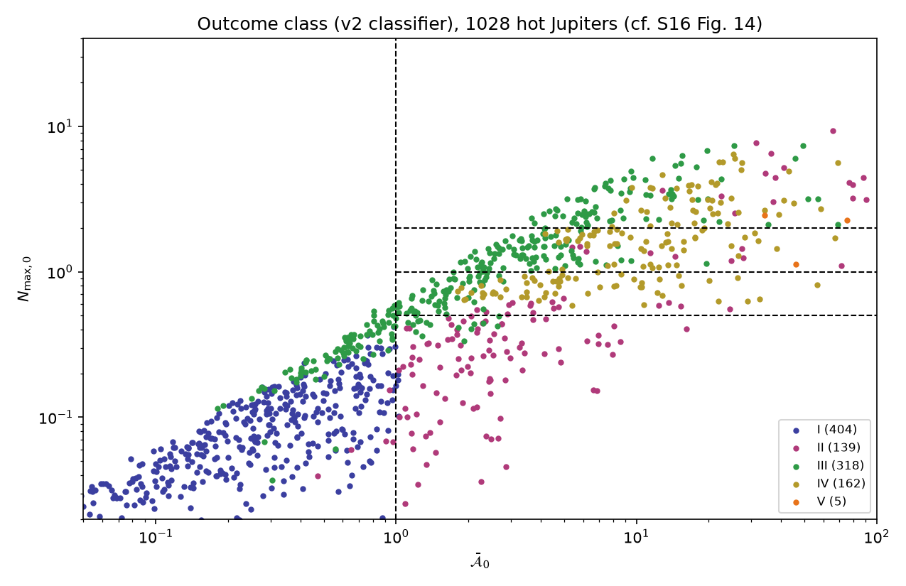

# Step 5: regime map from 1028 migrating systems, and an outcome classifier (SQ1 baseline)

| | |
|---|---|
| Answers brief | `docs/brief/planet-formation-and-spin-orbit-dynamics--how-does-stellar-spin-evolve-during-lidov-kozai-migration.md` |
| Brief SHA-256 | `11966760d9b6fc5e008207e46cd21e6b5dfb3c2160a9453c8ac546143dd1c3c3` |
| Work plan step | 5 (reproduce the S16 regime map; automatic class labeller validated by hand on 50 cases). This is case (a) of SQ1. |
| Builds on | findings 01 (corrected map thresholds), 03 (validated secular integrator) |
| Date | 2026-11-17 |
| Done by | Claude: Opus 5.5 (sample and ensemble design, hand labels, classifier revision, baselines, this write-up) with a Sonnet 5.5 subagent (integrator diagnostics, runs, first-pass features and montages). Not checked by a physicist. |
| Verify | `shasum -a 256 -c docs/SHA256SUMS` |

## Result

1. **The map reproduces.** The regime map for 1028 migrating systems looks like S16 Fig. 14. Class I fills $\bar{\mathcal A}_0<1$. Class II fills $\bar{\mathcal A}_0>1$ with $N_{\max,0}<0.5$. Classes IV and III share the region above $N_{\max,0}=0.5$.
2. **The map beats the brief's baseline.** S16's two-parameter map predicts the observed class for **63.6% of systems (95% bootstrap interval 60.6–66.7%)**. A classifier using $\theta_{lb}^0$ alone gets 47% (43–52%), so case (a) is not a negative result.
3. **Most errors are chaos the map can't see.** 214 of the 424 systems the map calls IV are chaotic (III).
4. **A third parameter controls chaos.** Chaos versus advection is set by $\hat\Omega_L=N_{\max,0}/(2\bar{\mathcal A}_0)$, S16's own orbit-shape ratio, which is not a coordinate of the map. Among predicted-IV systems, the chaotic fraction rises from 7% to 100% across the range of $\hat\Omega_L$. At fixed $N_{\max,0}$ it is 2–24% below the median $\hat\Omega_L$ and 81–87% above it. Adding a single cut at $\hat\Omega_L\ge0.13$ (calling those IV systems III) raises accuracy to **76% (73–80%) on held-out data**. $\hat\Omega_L$ correlates with $\theta_{lb}^0$ at −0.98, which explains why S16's 87° orbit is chaotic and its 89° orbit advects (Fig. 8).
5. **The classifier is checked by hand.** It agrees with hand labels on 30/30 training cases and **17/18 held-out cases**; two more held-out cases are genuinely ambiguous.

## Sample

Settings are in `config.toml` `[step5]`. The draw used seed 20261117 and 3000 systems:

| Parameter | Distribution |
|---|---|
| $M_p$ | uniform on 1–5 $M_J$ |
| $P_\star$ | log-uniform on 0.3–50 d |
| $a_b$ | uniform on 200–500 AU |
| $\theta_{lb}^0$ | uniform on 85–89.9° |

Everything else is as in step 4: $a_0=1.5$ AU, $e_b=0$, short-range forces, tides, no feedback. S16 Fig. 14 varies the same four quantities but doesn't give ranges.

1028 systems formed hot Jupiters within 5 Gyr, 1972 never migrated (mostly large $a_b$ or lower inclination), and none were disrupted. Only hot Jupiters are classified. The run took 170 s on 10 processes.

**Phase ensemble.** Each system has 10 members with $P_\star$ scaled by up to ±2%, plus a twin of the middle member whose spin starts 1e-8 rad off $\hat L$. With an aligned start, the only "phase" is the spin's phase when it leaves the shrinking resonance. A small change in $P_\star$ samples it; S16's own example flips branch between 30 and 29.87 d (Fig. 10). Without feedback, all 11 spins share one orbit integration.

**Diagnostics** (opt-in in `lkspin/secular.py`; behaviour with them off is bit-for-bit unchanged):
- eccentricity minima and maxima as events, interpolated with cubic Hermite splines;
- a winding number per LK cycle, $W_k=\frac1{2\pi}\int_{\rm cycle}\alpha\cos\theta_{sl}\,dt$. It locks near an integer when the spin is trapped in resonance $N$; our sign gives $W=-N$ in S16's convention;
- $\bar{\mathcal A}_0$ and $N_{\max,0}$ from the first LK cycle, as in step 4.

A cycle counts as LK-active while $e_{\max}-e_{\min}\ge0.1$. This is **assumed**: after LK is suppressed, $e$ keeps wiggling at the $10^{-4}$ level for hundreds of cycles, so "no more minima" can't mark the end.

## Classifier

**First pass** (subagent, physics-motivated thresholds). It agreed with the S16 map on only 29% of systems, and 303 systems came out unclassified. The 50-case hand check (`results/step5/handcheck_01..05.png`) showed why:

- **Class I with all members on one branch.** In I the ±2% ensemble often lands every member on the same branch. A rule demanding two populated clusters misses those.
- **Single short-lived lock.** A "last 50% of cycles" lock window misses advection whose LK-active phase is short.

**Hand labels** are in `results/step5/handlabels.csv`, one line of reasoning each. They follow S16's operational definitions:
- **III** is scatter of $\theta_{sl,f}$ across neighbouring $P_\star$ (S16 Fig. 8, lower panel). This is what the ±2% ensemble measures.
- **I** is non-adiabatic swinging, then freezing on one of two branches.
- **IV** is smooth advection with a winding lock.
- **II** is small and stationary.
- **V** is a tiny angle with fast, unlocked winding.

Cases 1–30 were used to design the rules; cases 31–50 were held out.

**Revised classifier v2** (`lkspin/regime.py: classify_v2`; thresholds in `[step5]` under `v2_*`), applied in this order:

1. **III** if the 10 members plus the twin do not fall into at most two clusters, each spanning 25° or less and separated by at least 30°.
2. **I** if member 0's $\theta_{sl}$ exceeds 90° at any eccentricity minimum.
3. **IV.N** if $W$ is within 0.15 of one non-zero integer $N$ in at least 30% of LK-active cycles.
4. **V** if every $\theta_{sl,f}<5°$ and the median $\lvert W\rvert\ge1$.
5. **II** otherwise.

Two rules were revised after the first v2 scoring, prompted by **training** misses only:
- **Swing window.** The swing is measured over the whole run, not just the LK-active phase. Case 19 crosses 90° only after LK stops.
- **Lock criterion.** A locked fraction replaced "10 consecutive locked cycles". Cases 23 and 30 have only 15–17 active cycles.

Before the revision, the held-out score was 16/18. Neither change was chosen by looking at held-out misses.

| | Training (1–30) | Held out (31–50) |
|---|---|---|
| agreement with hand labels | 30/30 | 17/18 (+2 ambiguous) |
| misses | — | case 40: V called II |
| ambiguous | — | case 46 sits on the II/IV boundary ($N_{\max,0}=0.496$, ensemble split, v2 says III); case 48 is II or IV.1 at onset (θ about 5°, v2 says II) |

v2 counts over all 1028 systems: I 404, II 139, III 318, IV 162 (IV.1 68, IV.2 51, IV.3 22, IV.4+ 21), V 5.

## SQ1 case (a): predicted against observed

S16's map (findings 01) assigns I if $\bar{\mathcal A}_0<1$, II if $\bar{\mathcal A}_0\ge1$ and $N_{\max,0}<0.5$, and IV otherwise. It has no III or V region. `results/step5/confusion_v2.txt`:

| predicted \ observed | I | II | III | IV | V | total |
|---|---|---|---|---|---|---|
| I | **401** | 5 | 88 | 0 | 0 | 494 |
| II | 3 | **91** | 16 | 0 | 0 | 110 |
| IV | 0 | 43 | 214 | **162** | 5 | 424 |

Accuracy by predicted class: I 81%, II 83%, IV 38%. The map's failures are almost all III, chaos it has no region for. The next largest group is 43 predicted-IV systems that stay II, near the $N_{\max,0}=0.5$ line.

**Baselines** (`scripts/step5_baselines.py`, `results/step5/baselines.json`). Fitted baselines are trained on a random half and scored on the other half, with 2000 bootstrap resamples:

| Classifier | Accuracy (95% interval) |
|---|---|
| S16 map, all 1028 | 63.6% (60.6–66.7%) |
| S16 map, test half | 62.8% (58.5–67.1%) |
| $\theta_{lb}^0$ alone (majority class per decile) | 47.4% (42.9–51.8%) |
| S16 map + "III if $\hat\Omega_L\ge0.13$" (cut fitted on the training half) | 76.4% (72.8–80.1%) |

**Chaos fraction against $\hat\Omega_L$** among predicted-IV systems, in sextiles:

| $\hat\Omega_L$ | 0.005–0.049 | 0.049–0.092 | 0.092–0.137 | 0.137–0.184 | 0.184–0.233 | 0.233–0.323 |
|---|---|---|---|---|---|---|
| III fraction | 0.07 | 0.15 | 0.28 | 0.61 | 0.92 | 1.00 |

Physically, $2\hat\Omega_L$ is the rate at which $\hat L$ changes over an LK cycle, in units of $n_e$. Larger $\hat\Omega_L$ means stronger forcing per precession, so the resonances widen and overlap. This is S15's overlap mechanism, and SQ4 should test it directly.

## Caveats

- **What III means here.** III is defined by scatter across ±2% in $P_\star$. That captures S16's operational chaos, but it can also catch a smooth class boundary that happens to fall inside the 2% window (case 46). The twin divergence is stored (`features.npz: twin_div_deg`) for a stricter, fixed-parameter chaos test.
- **Ensemble coverage.** The ensemble members of a class I system often sit on one branch, so this sample can't measure branch probabilities. That is SQ2's job, and it needs wider phase sampling.
- **Assumed thresholds.** The LK-activity threshold (0.1) and all v2 thresholds are judgement calls. They are listed in `config.toml` with their reasons.
- **Coordinate offset.** Our $\bar{\mathcal A}_0$ and $N_{\max,0}$ coefficients sit about 5% below S16's (findings 03), which shifts points slightly relative to S16's map lines.

## Files

`scripts/step5_run.py` (sample and runs), `step5_plots.py` (first-pass map and montages), `step5_validate.py`, `step5_classify.py` (v2 classifier, scoring, map), `step5_baselines.py`. Data is in `results/step5/`: `features.npz`, `series.npz` (per-cycle series for member 0, the middle member and the twin), `labels_v2.npz`, `handlabels.csv`, `handcheck_score_v2.json`, `confusion_v2.txt`, `baselines.json`. Tests are in `tests/test_regime.py`.
