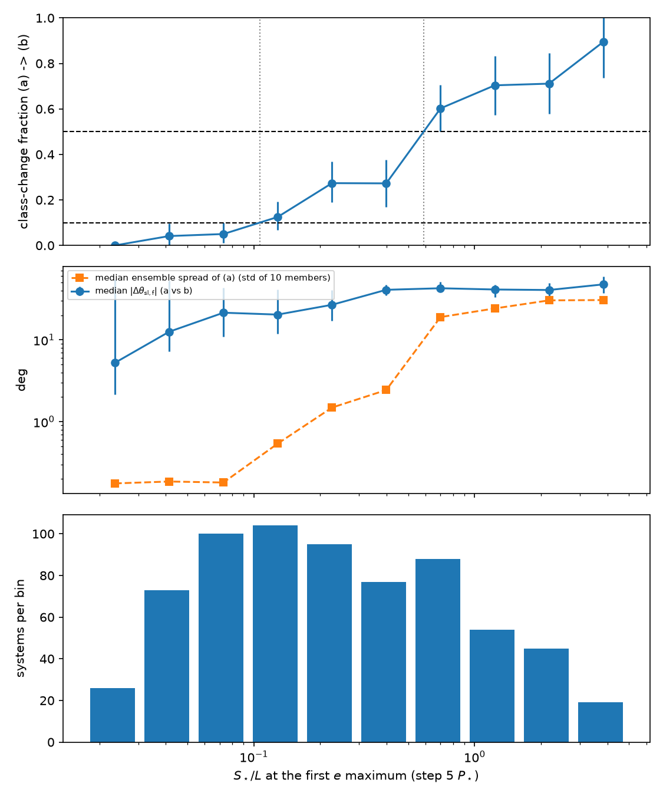

# Steps 6 and 10: SQ1 under fuller physics (feedback, octupole, spin-down) and the SQ5 feedback threshold

| | |
|---|---|
| Answers brief | `docs/brief/planet-formation-and-spin-orbit-dynamics--how-does-stellar-spin-evolve-during-lidov-kozai-migration.md` |
| Brief SHA-256 | `11966760d9b6fc5e008207e46cd21e6b5dfb3c2160a9453c8ac546143dd1c3c3` |
| Work plan steps | 6 (SQ1 cases b–d) and 10 (SQ5) |
| Builds on | findings 04 (step 5 sample, v2 classifier, case (a)) |
| Date | 2026-11-17 |
| Done by | Claude: Opus 5.5 (design, review of the physics against A16, interpretation, this write-up) with a Sonnet 5.5 subagent (implementation, validation, analysis scripts). Not checked by a physicist. |
| Verify | `shasum -a 256 -c docs/SHA256SUMS` |

## Result

1. **SQ1 gives the brief's negative result.** With spin-orbit feedback switched on, S16's $(\bar{\mathcal A}_0,N_{\max,0})$
   classification is **no better than a classifier that uses $\theta_{lb}^0$ alone**. That holds in all three cases with fuller physics.
   On held-out halves:

   | Case | S16 map | θ_lb0 alone |
   |---|---|---|
   | (b) feedback | 55% | 64% |
   | (c) feedback + octupole | 53% | 62% |
   | (d) feedback + octupole + spin-down | 56% | 69% |

   The brief lists this as one way the question is "not answerable this way". Without feedback (case a) the map scores
   63% against 47% for $\theta_{lb}^0$ alone (findings 04).
2. **Feedback all but removes adiabatic advection.** Class IV falls from 162 systems in (a) to 1 in (b), 2 in (c) and 0 in (d).
   Advection needs fast spin (large $N_{\max,0}$), and fast spin means large $S/L$, which is where feedback is strongest.
   S16 itself calls its analysis "somewhat pedagogical" for fast spinners. A quarter to a third of the systems also stop
   forming hot Jupiters in all 11 ensemble runs.
3. **SQ5: feedback changes the outcome class above $S/L\approx0.1$.** Here $S/L$ is evaluated at the first eccentricity maximum. The class-change fraction passes **10% at
   $S/L\approx0.11$ (95% interval 0.07–0.14)** and **50% at $S/L\approx0.59$ (0.52–0.70)**. Above $S/L\approx1$ it is
   70–90%.

## Physics added

All additions are opt-in in `lkspin/secular.py`, and existing paths are unchanged bit for bit. Settings are in `config.toml` `[step6]`.

| Case | Physics | Source |
|---|---|---|
| (b) | Feedback: $d\mathbf L/dt|_{\rm SL}=\Omega_{ps}\mathbf S_\star\times\hat L$ and $d\mathbf e/dt|_{\rm SL}=-\dot\omega_\star[\cos\theta_{sl}\hat S\times\mathbf e+\tfrac12(1-5\cos^2\theta_{sl})\hat L\times\mathbf e]$. Each ensemble member now needs its own integration. | A16 appendix |
| (c) | + octupole. $e_b$ is uniform on [0, 0.8], and $\hat e_b$ has a uniform azimuth (seed 6). $a_b$ is set so that $a_{b,\rm eff}$, and hence the quadrupole $t_k$, is unchanged from (a); only the octupole is added. $\varepsilon_{\rm oct}=(a/a_b)\,e_b/(1-e_b^2)$. | A16 Eqs. Lvec, evec, epsilonOct |
| (d) | + Skumanich spin-down, $\dot\Omega_\star=-\alpha_{\rm MB}\Omega_\star^3$ with $\alpha_{\rm MB}=1.5\times10^{-14}$ yr (G star), starting at $t=0$ (**assumed**: stellar age zero) | A16 l.420–423 |

**A16 typo.** A16's printed octupole $d\mathbf L/dt$ (Eq. `eq:Lvec`, l.1763–1777) has $(\mathbf e\cdot\hat L_b)$ in two places where the
mirror-image $d\mathbf e/dt$ and Liu et al. 2015 have $(\mathbf e\cdot\hat e_b)$. In the first bracket that's
$2[(\mathbf e\cdot\hat e_b)(\mathbf j\cdot\hat L_b)+\dots]$ and $-7(\mathbf e\cdot\hat e_b)(\mathbf e\cdot\hat L_b)$.
The printed form breaks $\mathbf j\cdot\mathbf e=0$ and the conserved quantity at relative order 1–4. The corrected form
keeps them to $5\times10^{-16}$ and matches REBOUND (below). We use the corrected form. This is the third equation-level
problem found in A16, after the tidal-bulge factor (findings 03).

## Validation (`scripts/step6_validate.py`, `results/step6/validation.json`)

| Check | Result |
|---|---|
| LK, SRFs and tides off; feedback on | $\mathbf S+\mathbf L$ conserved to $2.4\times10^{-15}$ relative over 38 precession periods |
| LK on (quadrupole) with feedback | $(\mathbf S+\mathbf L)\cdot\hat L_b$ conserved to $3\times10^{-15}$. $H_Q+H_{SL}$ conserved to $2\times10^{-16}$ while each part varies by $3\times10^{-7}$, which confirms A16's $\tfrac12(1-5\cos^2\theta)$ term comes from $H_{SL}$. |
| Octupole against REBOUND (IAS15, point masses), $\varepsilon_{\rm oct}=0.0137$, 85°, $e_b=0.7$, 30 $t_k$ | the six successive $e_{\max}$ agree; $1-e_{\max}$ ratio 0.93–0.98; peak times within 0.02–0.23 $t_k$. Flipping $\hat e_b$ changes the sequence strongly, so the test can discriminate. |
| Quadrupole invariants with octupole on | drift scales with $\varepsilon_{\rm oct}$ (ratio 1.98–2.14 per halving) |
| Spin-down against the analytic Skumanich solution | $2.5\times10^{-10}$ relative to 5 Gyr |
| Feedback scaled to zero against step 5 | regular systems agree to 7.5e-4° or better, which is integrator accuracy (the brief's "exact" is not reachable). Chaotic ones don't agree, and step 5 itself moves about 100° under a 100× tolerance change. |
| Existing paths | step 4 pilot bit-identical; all 49 tests pass |

## SQ1: confusion matrices

The predicted class comes from S16's map (findings 04); the observed class from the v2 classifier. Only systems that form
a hot Jupiter in all 11 ensemble runs are classified. Full matrices, (a)→case transitions and maps are in
`results/step6/confusion_{a,b,c,d}.txt`, `{a,b,c,d}_map.png` and `summary.json`. Intervals are 95% bootstrap (2000 resamples).

| Case | Classified | Timeout / mixed | Observed I / II / III / IV / V | Map accuracy, all | Map, test half | θ_lb0 alone, test half | Map + $\hat\Omega_L$ cut, test half |
|---|---|---|---|---|---|---|---|
| (a) | 1028 | 0 / 0 | 404 / 139 / 318 / 162 / 5 | 63.6% (60.6–66.6) | 62.8% (58.5–67.1) | 47.4% (42.9–51.8) | 76.4% (72.4–80.1), cut 0.13 |
| (b) | 681 | 204 / 143 | 445 / 45 / 190 / 1 / 0 | 57.4% (53.7–60.9) | 55.0% (49.2–60.8) | **64.0% (58.8–69.1)** | 62.7% (57.2–68.2), cut 0.02 |
| (c) | 664 | 188 / 176 | 421 / 38 / 203 / 2 / 0 | 56.3% (52.6–60.1) | 53.1% (47.6–58.6) | **61.8% (56.3–67.0)** | 62.5% (57.0–68.0), cut 0.02 |
| (d) | 701 | 247 / 80 | 497 / 100 / 104 / 0 / 0 | 61.8% (58.2–65.3) | 56.1% (50.4–61.2) | **69.3% (64.2–74.0)** | 66.3% (61.5–71.3), cut 0.02 |

"Timeout" means at least one ensemble member did not migrate within 5 Gyr, and "mixed" means the members disagreed. With
feedback, the star's quadrupole adds pericentre precession comparable to GR at $e_{\max}$ when $S/L\sim1$. That lowers
$e_{\max}$ and pushes marginal systems out of migration.

**Where the map fails** in (b), by row:
- **Predicted I:** 80% stay I; the rest are III.
- **Predicted II:** only 27% stay II; 42 become III and 28 become I.
- **Predicted IV:** of 129, 1 is IV, 53 are I, 56 are III and 19 are II.

Spin-down (d) makes the stars slower and less adiabatic. It turns much of predicted II into I (52), keeps chaos lower
(104 systems against 190 in b), and leaves no advection.

**Paired transitions from (a) to (b)** for the 681 common systems:
- 208 change family (31%).
- Of the 39 systems that were IV in (a) and still migrate, 10 become I, 19 become III, 9 become II, and 1 stays IV.
- Becoming I needs a swing past 90°, and becoming III needs scatter across the ensemble, and advection does neither. So those transitions are changes in the dynamics, not a missed resonance lock.

## SQ5: class change against $S/L$ (`scripts/step10_sq5.py`, `results/step10/sq5.json`)

Pairs (a) with (b) per system. $S/L$ is taken at the first eccentricity maximum, for the middle member.

| $S/L$ (bin centre) | 0.024 | 0.041 | 0.073 | 0.13 | 0.23 | 0.40 | 0.70 | 1.23 | 2.17 | 3.82 |
|---|---|---|---|---|---|---|---|---|---|---|
| systems | 26 | 73 | 100 | 104 | 95 | 77 | 88 | 54 | 45 | 19 |
| class-change fraction | 0.00 | 0.04 | 0.05 | 0.13 | 0.27 | 0.27 | 0.60 | 0.70 | 0.71 | 0.90 |
| median $\lvert\Delta\theta_{sl,f}\rvert$ (deg) | 5.2 | 12.6 | 21.5 | 20.4 | 26.8 | 40.9 | 42.7 | 41.3 | 40.7 | 47.6 |
| median within-ensemble spread in (a) (deg) | 0.18 | 0.19 | 0.18 | 0.54 | 1.5 | 2.4 | 19.0 | 24.2 | 30.4 | 30.6 |

- **Class changes.** They cross 10% at $S/L=0.11$ (0.07–0.14) and 50% at $S/L=0.59$ (0.52–0.70).
- **Angle shifts.** The median $\lvert\Delta\theta_{sl,f}\rvert$ exceeds the within-ensemble spread of (a) in every bin, so the third
  threshold the brief asks for ("shifts $\theta_{sl,f}$ by more than the class-internal spread") lies below the sampled
  range, $S/L\lesssim0.02$. Treat this as an upper bound. At low $S/L$ most systems are class I. Their 2% ensembles often sit on one branch, so the spread
  understates the real phase sensitivity, and even a small feedback torque can move the separatrix-exit phase.

## Caveats

- **Classifier not re-validated with feedback.** v2 was hand-validated only without feedback (findings 04). With feedback the winding $W$ still measures
  spin precession per LK cycle, but $\hat L$ also precesses about $\hat S$, so a resonance lock could be missed. The 9
  IV→II transitions are the cases where this could matter. The I and III transitions don't depend on the lock.
- **Selection.** Only systems that migrate in all 11 runs are classified. Feedback removes a third of them, preferentially fast
  spinners, which are the would-be IV systems. The accuracies are therefore for different, smaller populations than (a).
- **Assumptions.** Spin-down starts at $t=0$. The octupole $e_b$ range (0–0.8) and the trick of fixing $a_{b,\rm eff}$ are design
  choices, so (c) isolates the octupole term rather than sampling a realistic binary population.
- **$\hat\Omega_L$ cut.** The fitted cut drops to 0.02 in (b)–(d) and adds little, so its success in (a) does not carry over once feedback is on.

## Not done

- No hand validation of the classifier on feedback runs.
- No $S/L$ scan at fixed $(\bar{\mathcal A}_0,N_{\max,0})$, which the brief offers as an option.
- No attempt to say which physical channel (the precession of $\hat L$ about $\hat S$, or the $\dot\omega_\star$ change to $e_{\max}$) drives the class changes. One could switch them on separately.
